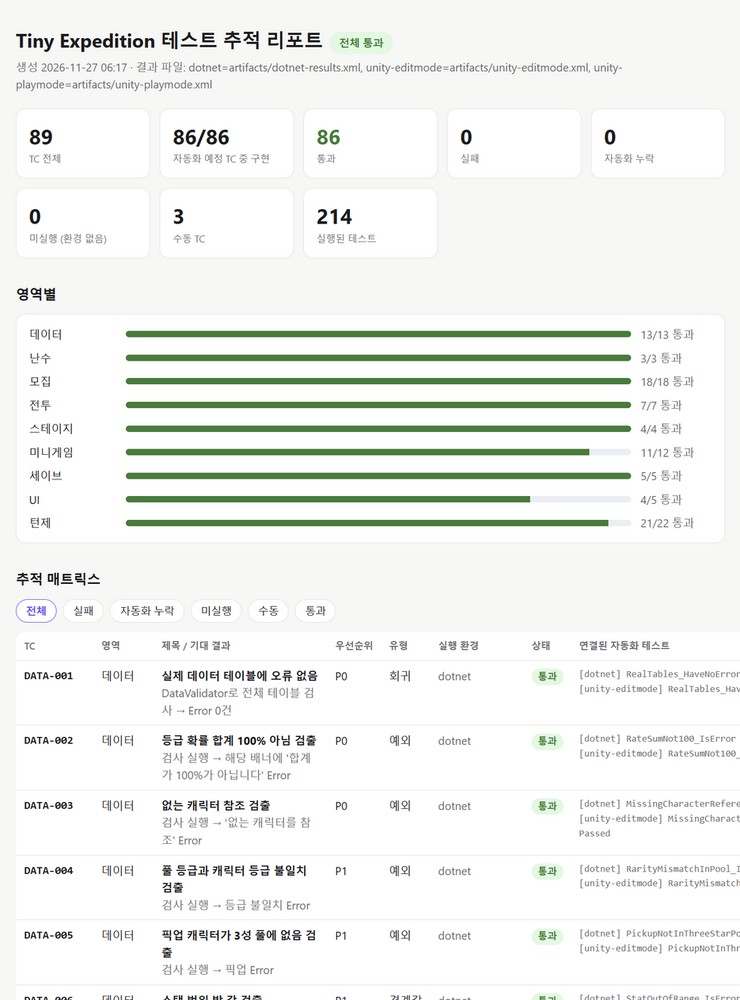
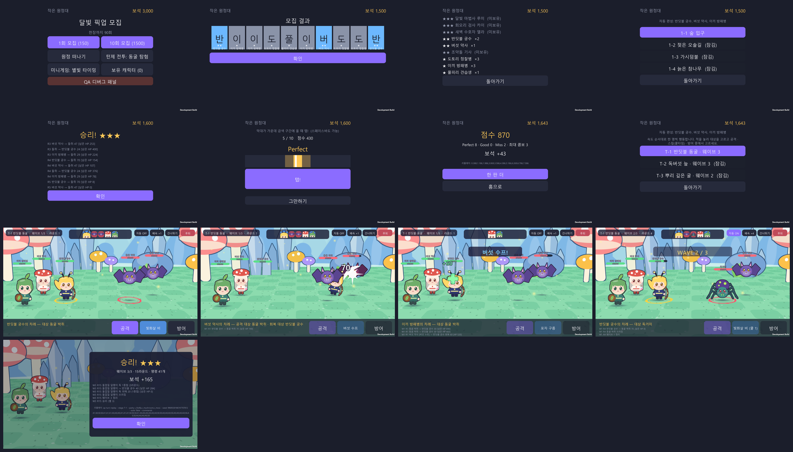

# 작은 원정대 (Tiny Expedition) — 게임 QA 자동화 포트폴리오

[](https://github.com/ppastar/tiny-expedition-qa/actions/workflows/qa.yml)

모집(가챠)·자동 전투·미니게임이 있는 작은 Unity 게임을 직접 만들고,
**테스트 케이스 설계 → 자동화 테스트 → QA 도구 → CI**까지 한 흐름으로 구현한 프로젝트입니다.

QA로 일을 시작해 SDET·플랫폼 엔지니어로 넘어온 경험을 게임 도메인에 옮겨 본 것으로,
"수집형 RPG를 출시·운영할 때 QA가 실제로 걱정하는 것"을 기준으로 만들었습니다.

- 확률표와 실제 확률이 다르지 않은가 (확률형 아이템 정보 공개)
- 기획 데이터 한 줄 실수가 그대로 빌드에 들어가지 않는가
- 재화가 두 번 지급되거나 빠지지 않는가
- "가끔 일어나는" 전투·미니게임 버그를 그대로 재현할 수 있는가

> 게임의 캐릭터·이름·그림·규칙 수치는 모두 이 프로젝트용으로 새로 만든 것입니다.

## 한눈에 보기

| 항목 | 내용 |
|---|---|
| 게임 | Unity 6 (6000.5) · uGUI를 코드로 구성 · 모집 / 원정(자동 전투) / **턴제 전투**(속도 순서·스킬 쿨타임·기절/독·3웨이브) / 미니게임 "별빛 타이밍" / QA 디버그 패널 |
| TC 문서 | [`docs/test-cases.csv`](docs/test-cases.csv) — 89개 (자동화 86 · 수동 3), 영역·우선순위·유형·실행 환경 포함 |
| 테스트 계획 | [`docs/TEST_PLAN.md`](docs/TEST_PLAN.md) — 위험별 대응, TC 작성 기준, 릴리스 기준, 개발 단계(프로토타입 → 알파 → CBT → 출시 → 라이브)별 범위·진입/종료 기준·산출물 |
| 체크리스트 | [`docs/checklists/`](docs/checklists/) — 빌드 스모크 12항목(10~15분) · 아웃게임 릴리즈 30항목, 구글 시트로 가져갈 수 있는 CSV, 항목마다 관련 TC |
| 버그 리포트 | [`docs/bug-reports/`](docs/bug-reports/) — Jira 양식. 실제 결함 2건(모두 수정, 회귀 TC 있음) + 시연용 3건(일부러 넣은 결함), 시드·리플레이로 실제 재현한 출력 첨부 |
| 기획 리뷰 | [`docs/spec-review/gacha.md`](docs/spec-review/gacha.md) — 모집·천장 규칙 11개 정리, 질문 13개·리스크·TC 연결 (리뷰 중 실제 결함 1건 발견·수정) |
| 자동화 테스트 | NUnit 104개 — dotnet과 Unity EditMode에서 같은 소스로 실행, 둘 다 통과 / Unity PlayMode UI 테스트 6개 통과 / 실제 빌드 자동 플레이 스모크 |
| 커버리지 | 게임 규칙(Core) 라인 95.4% (턴제 `TurnBattle` 98.4%) · 화면(Game) 63.7% — Unity Code Coverage ([요약](docs/reports/coverage-summary.md)) |
| QA 도구 | `qa-tool` CLI — 데이터 검사 · 확률 검증 · 전투/턴제/미니게임 리플레이 · TC 추적 리포트 / 뮤테이션 스모크 31/31 · 빌드 자동 플레이(`-qaAutoplay`) · Unity 에디터 메뉴·빌드 전 데이터 검사 훅 |
| CI | GitHub Actions — 테스트·데이터 검사·확률 검증(배너당 100만 회)·추적 리포트를 push·PR마다, 뮤테이션 스모크를 PR·수동 실행 때 돌림 (Ubuntu에서 통과 확인) |

## 구조

```
UnityProject/Assets/
  TinyExpedition/
    Core/            ← 게임 규칙 전부 (엔진 참조 없음, noEngineReferences)
      Random/          PCG32 시드 난수 (런타임이 달라도 같은 수열)
      Data/            기획 데이터 로더 + DataValidator
      Gacha/           모집·천장·10연 보정, 천장 포함 실제 확률 계산
      Battle/          결정적 자동 전투 시뮬레이터 + 턴제 전투(시드 + 명령 목록으로 리플레이)
      MiniGame/        타이밍 탭 판정·콤보·리플레이
      Progress/        세이브 직렬화·변조 검사
      GameSession.cs   UI와 테스트가 함께 쓰는 입구
    Game/            ← 화면 (Core를 보여주고 입력만 넘김)
    Editor/          ← 에디터 메뉴, 빌드 전 데이터 검사 훅, CI용 진입점
    Tests/Shared/    ← NUnit 테스트 (Unity EditMode와 dotnet test가 같은 파일을 컴파일)
    Tests/PlayMode/  ← 실제 화면을 띄워 버튼을 누르는 UI 테스트
  StreamingAssets/GameData/   characters.json · banners.json · stages.json · skills.json · turn-stages.json
dotnet/              ← Core·테스트를 Unity 없이 빌드하는 프로젝트 + qa-tool
docs/                ← TC 문서, 테스트 계획
  checklists/          빌드 스모크·아웃게임 릴리즈 체크리스트 (CSV)
  bug-reports/         버그 리포트 (BUG = 실제 결함, DEMO = 시연용)
  spec-review/         기획 리뷰 (모집·천장)
  reports/             확률 검증·TC 추적·커버리지 리포트, 자동 플레이 스크린샷
samples/broken-data/ ← 일부러 틀리게 만든 기획 데이터 (도구 시연용)
scripts/             ← 전체 파이프라인, Unity 테스트 실행, 뮤테이션 스모크
```

### 왜 이렇게 나눴나

게임 규칙을 엔진과 분리한 `Core`에 모았습니다. 그래서

1. **테스트가 빠릅니다.** 104개가 1초 안에 끝나고, Unity를 켜지 않고도 CI에서 돌 수 있습니다(Unity 라이선스 불필요).
2. **같은 테스트를 두 곳에서 돌립니다.** `Tests/Shared`는 Unity EditMode 테스트 어셈블리이면서, `dotnet/Core.Tests`가 같은 파일을 링크해 컴파일합니다. 난수를 PCG 공식 레퍼런스 값과 대조하는 테스트(RNG-001)가 .NET과 Unity(Mono) 양쪽에서 통과해, 런타임이 달라도 같은 시드면 같은 결과가 나옴을 확인했습니다.
3. **도구가 게임 코드를 그대로 씁니다.** 확률 검증기는 확률 로직을 따로 다시 짜지 않고, 게임이 쓰는 `GachaService`를 그대로 100만 번 돌립니다. 검증 대상과 검증 도구가 어긋날 일이 없습니다.

공유 소스는 Unity 6 컴파일러에 맞춰 C# 9 문법으로 제한했습니다(`Directory.Build.props`의 `LangVersion`). C# 10 이상 문법을 쓰면 dotnet 빌드에서 먼저 깨집니다.

## 테스트 전략

| 층 | 무엇을 | 어디서 | 수 |
|---|---|---|---|
| 규칙 단위 테스트 | 모집·천장·전투 공식·턴제 경계(순서·쿨타임·상태이상·전멸·보상)·판정 경계·세이브 | dotnet + Unity EditMode | 104 |
| 통계 테스트 | 등급 분포(카이제곱), 픽업 비율(천장 3성 포함), 천장 포함 실제 확률 | 위와 같음 (시드 고정이라 흔들리지 않음) | 4 (위 104에 포함) |
| 데이터 테스트 | 실제 테이블 검사 + 잘못된 테이블을 잡는지 | 위와 같음 + Unity 빌드 훅 | 18 (위 104에 포함) |
| UI E2E | 부팅 → 모집 → 결과, 미니게임 한 판, 그림 누락, 턴제 대상 선택·공격·자동·보상, 턴제 후퇴 | Unity PlayMode | 6 |
| 빌드 스모크 | 실제 Windows 개발 빌드가 홈→모집→전투→미니게임→턴제 전투를 스스로 진행, 단계별 스크린샷 | `TinyExpedition.exe -qaAutoplay <폴더>` | 1 흐름 |
| 수동 탐색 | 실기기 터치 지연, 화면 비율, 턴제 템포·가독성 | 사람 | 3 |

TC 문서의 모든 자동화 TC는 테스트 코드에 `[TC("GACHA-004")]`처럼 번호가 붙어 있어,
리포트 도구가 **TC 문서 ↔ 테스트 ↔ 결과**를 자동으로 잇습니다. 문서에만 있고 테스트가 없는 TC, 테스트에만 있고 문서에 없는 번호는 리포트에서 실패로 잡힙니다.

자세한 기준은 [`docs/TEST_PLAN.md`](docs/TEST_PLAN.md)에 있습니다.

## 결과물 미리보기

- [모집 확률 검증 리포트](docs/reports/gacha-report.md) (배너당 100만 회)
- TC 추적 리포트 화면: `docs/reports/test-report.png` / [HTML](docs/reports/test-report.html)



## QA 도구

```bash
cd dotnet && dotnet build && cd ..
alias qa="dotnet run --project dotnet/QaTool --no-build --"
```

### 1. 확률 검증기 `qa gacha-verify`

게임의 모집 코드를 배너당 100만 번 돌려 공시한 확률표와 비교합니다.

- 기본 등급 확률: 카이제곱 적합도 검정 (p ≥ 0.001), 등급별 95% 신뢰구간
- 등급 안 캐릭터 분포: 픽업 50% / 나머지 균등이 맞는지
- **천장 포함 실제 3성 확률**: 기본 2.5% + 90회 천장이면 실제로는 약 2.79%. 공시값과 관측값을 비교
- 천장 동작: 3성 사이 간격이 90회를 넘지 않는지, 간격 분포 히스토그램
- 10연 보정: 10만 번의 10연 중 2성 이상이 없는 경우가 0번인지

```
[b_lumi] 달빛 픽업 모집
  PASS  기본 등급 확률 — χ²=5.71 (자유도 2), p=0.0575
  PASS  ★★★ 캐릭터 분포 — χ²=0.23, p=0.8912
  PASS  공시한 실제 3성 획득률 — 관측 2.787% vs 공시 2.79% (허용 ±0.071%)
  PASS  천장 동작 — 가장 긴 간격 90회 / 천장 90회
  PASS  10연 2성 이상 보정 — 10연 100,000번 중 위반 0번
```

### 2. 기획 데이터 검사기 `qa validate-data`

확률 합계 100%, 없는 캐릭터 참조, 풀 등급 불일치, 픽업 누락, 스탯 범위, 스테이지 선행 관계 순환,
턴제 스킬(없는 스킬 참조, 쿨타임·위력·상태이상 범위, 회복 스킬에 상태이상), 턴제 웨이브 수·적 수,
**공시한 천장 포함 확률이 계산값과 맞는지**까지 검사합니다. 같은 검사가 Unity 빌드 직전 훅(`IPreprocessBuildWithReport`)에도 걸려 있어, 데이터가 틀리면 빌드가 실패합니다.

```
$ qa validate-data --data samples/broken-data
[Error] banners/b_standard: 등급 확률 합계가 100%가 아닙니다: 99.5%
[Error] banners/b_standard: 공시한 천장 포함 3성 확률 2.5%가 계산값 2.79%와 다릅니다.
[Error] banners/b_lumi: 없는 캐릭터를 참조합니다: c_lumii
[Error] stages/1-1: 선행 스테이지가 순환합니다.
...
[Error] skills/s_cd_typo: cooldown 값 30이(가) 허용 범위 0~9를 벗어났습니다.
[Error] skills/s_heal_stun: 자기편 대상(회복) 스킬에는 상태이상을 붙일 수 없습니다.
[Error] turn-stages/T-1: w1.박쥐이(가) 없는 스킬을 참조합니다: s_bite
[Error] turn-stages/T-1: 웨이브 2의 적은 최대 3마리입니다.
...
캐릭터 10 · 배너 2 · 스테이지 4 · 스킬 4 · 턴제 스테이지 2 — 오류 17, 경고 0
```

### 3. 버그 재현 도구 `qa battle-replay` / `qa minigame-replay`

전투와 미니게임은 시드·입력 기록만 있으면 언제든 같은 결과가 나오도록 만들었습니다.
버그 리포트에 시드(또는 미니게임 결과 화면의 리플레이 문자열)만 적으면 개발자가 그대로 재현할 수 있습니다.

```
$ qa battle-replay --stage 1-3 --party c_lumi,c_firefly,c_moss --seed 5
$ qa minigame-replay --taps 0.41,1.93,2.77,3.6,4.42,5.55,6.01,7.2,8.39,9.0
```

턴제 전투는 사람이 명령을 고르므로 **시드 + 아군 명령 목록**이 리플레이 단위입니다(`A1` = 1번 적 공격, `S0` = 스킬(대상 0번), `G` = 방어).
전투 결과 화면에 이 명령줄이 그대로 찍혀, 복사해 붙이면 같은 전투가 다시 나옵니다. 명령이 모자라면 `--auto false`로 그 자리에서 멈춰 "이 차례에서 무엇이 보였는지"를 확인할 수 있습니다.

```
$ qa turn-replay --stage T-1 --party c_kai,c_firefly,c_acorn --seed 3 --commands A1,S0,G
  W1 R1 회오리 검사 카이 → 동굴 박쥐 100 [남은 HP 160]
  W1 R1 반딧불 궁수 [빛화살 비] → 동굴 박쥐 52 [남은 HP 208]
  W1 R1 반딧불 궁수 [빛화살 비] → 동굴 박쥐 52 [남은 HP 108]
  W1 R1 도토리 정찰병 방어
  W1 R1 동굴 박쥐 → 도토리 정찰병 15(방어) [남은 HP 405]
  ...
  W2 R4 독거미 [독니] → 도토리 정찰병 30 [남은 HP 298]
  W2 R4 도토리 정찰병 독 1중첩 (3라운드)
  W2 R4 도토리 정찰병 독 피해 18 (1중첩) [남은 HP 280]
  ...
결과: Victory · 웨이브 3/3 · 11라운드 · 별 3
명령: A1,S0,G,S1,A0,S0,A0,A1,A1,A1,S1,A0,...   ← 앞 3개는 준 명령, 나머지는 자동
```

턴제 규칙(행동 순서 동점 처리, 쿨타임이 줄어드는 시점, 기절·독 중첩, 웨이브 전환, 동시 전멸 = 패배)은
[`TurnBattle.cs`](UnityProject/Assets/TinyExpedition/Core/Battle/TurnBattle.cs) 맨 위 주석에 기획서처럼 적어 두고, 경계마다 TC(TURN-001~024)를 붙였습니다.

### 4. TC 추적 리포트 `qa report`

dotnet과 Unity가 내는 NUnit XML을 TC 문서와 이어 HTML 리포트를 만듭니다.
TC별 상태(통과·실패·자동화 누락·미실행·수동), 영역별 통과율, 실패 메시지를 한 페이지로 봅니다.

```
$ qa report --results dotnet=artifacts/dotnet-results.xml,unity-playmode=artifacts/unity-playmode.xml \
            --cases docs/test-cases.csv --out artifacts/test-report.html
```

### 5. 뮤테이션 스모크 `scripts/mutation_smoke.py`

"테스트가 다 통과한다"는 것만으로는 테스트가 버그를 잡는지 알 수 없어서,
실제로 생길 법한 버그 31개(천장 off-by-one, 10연 안에서 천장 카운트 초기화 누락, `<`/`<=` 경계 혼동, 보상 중복 지급, 실패한 모집의 재화 차감, 콤보 초기화 누락, 턴제 쿨타임 off-by-one·동시 전멸 오판·기절 합산 등)를 코드에 하나씩 넣고 테스트가 실패하는지 확인합니다.

```
[검출] 천장 off-by-one (90번째가 아니라 91번째에 확정)  ← GACHA-004, GACHA-005, GACHA-011, GACHA-016, GACHA-017, GACHA-018
[검출] 10연 안에서는 3성이 나와도 천장 카운트가 초기화되지 않음 (1회 모집만 초기화)  ← GACHA-017, GACHA-018
[검출] 10연 보정 대상 장에서는 천장 판정을 건너뜀 (보정이 천장보다 먼저)  ← GACHA-018
[검출] 모집 실패해도 보석이 먼저 빠짐 (차감 순서 오류)  ← GACHA-015
[검출] 미니게임 보상 중복 수령  ← MINI-010
[검출] Perfect 판정 경계 미포함 (< 와 <= 혼동)  ← MINI-002
[검출] 10연 보정 대상(2성) 후보 검사 누락  ← DATA-010
...
[검출] [턴제] 쿨타임 경계 off-by-one (마지막 1턴 일찍 사용 가능)  ← TURN-003, TURN-004
[검출] [턴제] 동시 전멸을 승리로 판정  ← TURN-010
...
검출 31/31
```

### 6. 게임 안 QA 디버그 패널

시드 고정, 보석 지급, 천장 직전(89회)으로 이동, 모든 스테이지 열기, 세이브 초기화.
`UNITY_EDITOR || DEVELOPMENT_BUILD`에서만 컴파일되어 출시 빌드에는 들어가지 않습니다.

### 7. 빌드 자동 플레이 `-qaAutoplay`

개발 빌드를 `TinyExpedition.exe -qaAutoplay <폴더>`로 실행하면 홈 → 10연 모집 → 보유 캐릭터 → 원정 1-1 → 미니게임 한 판 → 턴제 T-1(대상 골라 직접 공격 한 번 → 끝까지 자동)을 스스로 진행하며 각 화면을 확인(화면 이름·버튼 활성)하고 스크린샷을 남긴 뒤 종료합니다. 하나라도 어긋나면 종료 코드 1. 미니게임은 실제 시간으로 막대를 보고 누르며, 일부러 4번째마다 빗나가게 해 Miss·콤보 초기화까지 지나갑니다.



## 실행

```bash
# 전체 파이프라인 (Unity 없이)
bash scripts/test-all.sh

# Unity 테스트까지 (Unity Hub 로그인 + 라이선스 활성화 필요)
UNITY="/c/Program Files/Unity/Hub/Editor/6000.5.6f1/Editor/Unity.exe" bash scripts/test-all.sh

# 뮤테이션 스모크
python scripts/mutation_smoke.py
```

Unity에서 열 때는 Unity Hub에서 `UnityProject` 폴더를 추가하고, 메뉴 **Tiny Expedition → Main 씬 만들기**를 한 번 실행한 뒤 Play 합니다.

## QA 문서

자동화와 별개로, 사람이 하는 게임 QA 실무 문서를 이 게임 기준으로 만들었습니다.

| 문서 | 내용 |
|---|---|
| [모집·천장 기획 리뷰](docs/spec-review/gacha.md) | 코드·데이터를 기획서로 놓고 규칙을 다시 적고, 규칙이 겹치는 곳(천장×10연, 천장×픽업, 보정×데이터)을 질문 13개로 정리. 각 질문을 TC 또는 "TC 추가 후보"로 연결하고, 모집 후보 3개는 TC(GACHA-016~018)·뮤테이션으로 만듦. 사후 작성임을 문서에 밝힘 |
| [버그 리포트](docs/bug-reports/README.md) | 요약·환경·심각도/우선순위·재현 절차·기대/실제·재현율·첨부·원인·수정 확인 |
| [빌드 스모크 CL](docs/checklists/build-smoke.csv) / [릴리즈 CL](docs/checklists/outgame-release.csv) | 새 빌드를 받았을 때 / 출시 전에 훑는 목록. `자동 확인` 열로 CI·자동 플레이가 이미 덮는 범위를 표시 |
| [개발 단계별 계획](docs/TEST_PLAN.md#7-개발-단계별-테스트-계획) | 단계마다 QA 범위, 다음 단계로 넘기는 기준, 남길 문서 |

버그 리포트 중 실제 결함은 두 건입니다.

- [BUG-001](docs/bug-reports/BUG-001-gems-taken-on-failed-pull.md) 모집이 데이터 오류로 실패해도 보석이 먼저 빠짐 — 수정 전 커밋(15562c3)에서 10/10 재현, 4458613에서 수정, 회귀 TC GACHA-015.
- [BUG-002](docs/bug-reports/BUG-002-ten-pull-guarantee-without-two-star-pool.md) "2성 0% + 2성 후보 없음 + 10연 보정" 배너가 데이터 검사를 통과하고 10연이 시드 100개 중 76개에서 실패 — 기획 리뷰 중 발견. 이 조합 때문에 BUG-001이 검사기를 통과하는 데이터로도 터질 수 있었음을 확인. PR #2에서 검사기 규칙으로 수정(이 배너는 이제 Error), 회귀 TC DATA-010 · GACHA-015.

나머지 3건(DEMO-001~003)은 뮤테이션 스모크용 결함을 일부러 넣고 재현한 **시연용**이며, 문서 맨 위에 그렇게 표시했습니다.

## AI와 함께 만든 방식

이 프로젝트는 Claude Code(AI 코딩 도구)와 함께 만들었습니다. 커밋에 `Co-Authored-By: Claude`가 붙어 있는 것이 그 기록입니다. 역할은 이렇게 나눴습니다.

| 누가 | 무엇을 |
|---|---|
| 사람(저) | 무엇이 위험한지(1장 위험 표), 어떤 TC가 필요한지, 판정 기준(카이제곱 유의수준, 허용 오차, 경계값 세 점), 릴리스 기준을 정함 |
| AI | 정한 기준에 맞춰 게임 코드·테스트·QA 도구·문서 초안을 구현하고, 실행해 결과를 보고 |
| 도구 | AI가 만든 테스트를 믿기 전에 검증 — 뮤테이션 스모크(그럴듯한 버그 31개를 넣어 테스트가 다 잡는지, 31/31), TC 추적 리포트(문서에 있는데 테스트가 없거나, 테스트에만 있는 TC 번호를 실패로 표시) |

AI가 쓴 테스트는 "통과한다"만으로는 믿을 수 없어서(아무것도 확인하지 않는 테스트도 통과합니다), **테스트가 실제로 버그를 잡는지**를 뮤테이션으로, **문서와 테스트가 어긋나지 않는지**를 추적 리포트로 확인하는 장치를 함께 만들었습니다. 이 문서들의 출력·수치도 모두 실제로 실행해 받은 값만 적었습니다.

## 현재 상태와 한계

- 규칙 테스트 104개는 dotnet·Unity EditMode(6000.5.6f1) 양쪽에서, UI 테스트 6개는 Unity PlayMode에서 통과했습니다. 세 결과를 합친 추적 리포트 기준 자동화 TC 86/86 통과, 수동 TC 3개. 실제 Windows 개발 빌드의 자동 플레이도 턴제 단계까지 통과했고, 그 판의 리플레이 명령줄을 `qa turn-replay`(.NET)로 돌려 같은 결과(승리·14라운드·명령 41개)가 나오는 것을 확인했습니다.
- 알려진 열린 결함 없음. 마지막 실제 결함 [BUG-002](docs/bug-reports/BUG-002-ten-pull-guarantee-without-two-star-pool.md)(데이터 검사기 규칙 누락)는 검사기 규칙 + DATA-010으로 수정.
- 같은 파이프라인과 뮤테이션 스모크가 GitHub Actions(Ubuntu)에서도 통과합니다. Unity 테스트는 라이선스가 필요해 로컬 스크립트로 돌립니다.
- 데이터를 `File` API로 읽으므로 Windows/에디터 기준입니다. Android·WebGL은 `UnityWebRequest`로 StreamingAssets를 읽도록 바꿔야 합니다.
- 한글 표시는 OS 폰트(맑은 고딕 등)에 기대고 있어 WebGL에서는 한글 폰트를 따로 넣어야 합니다.
