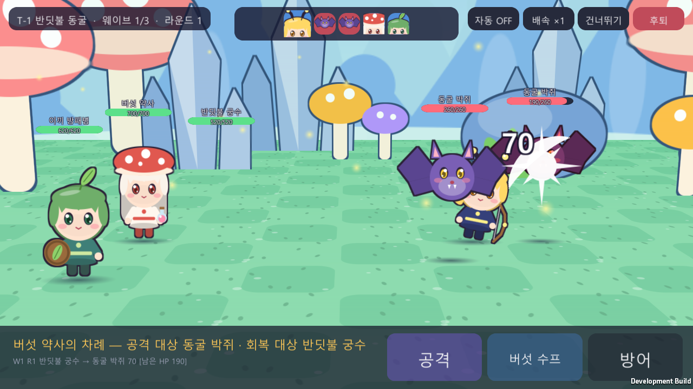
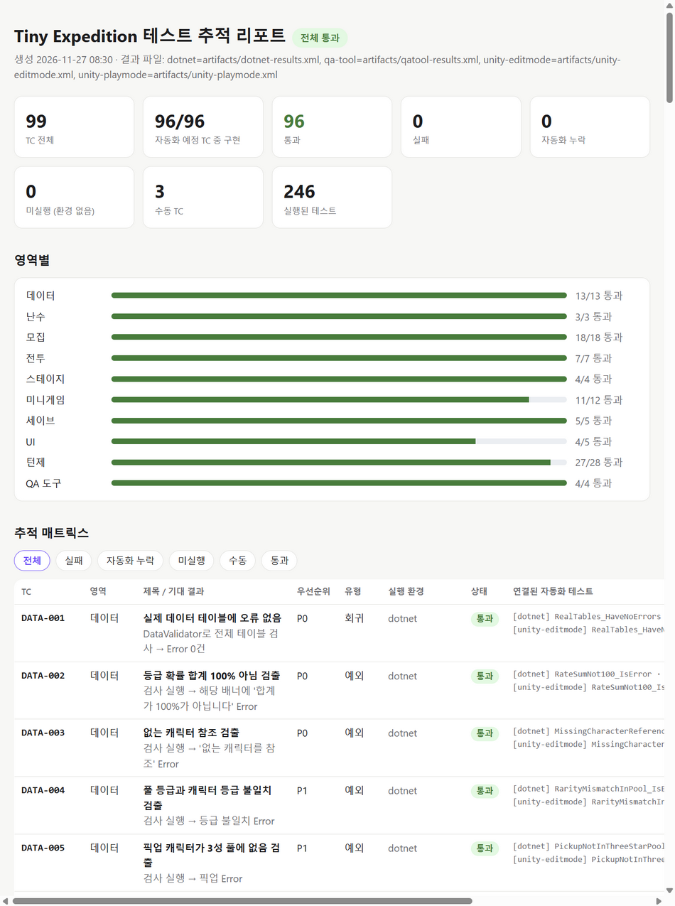
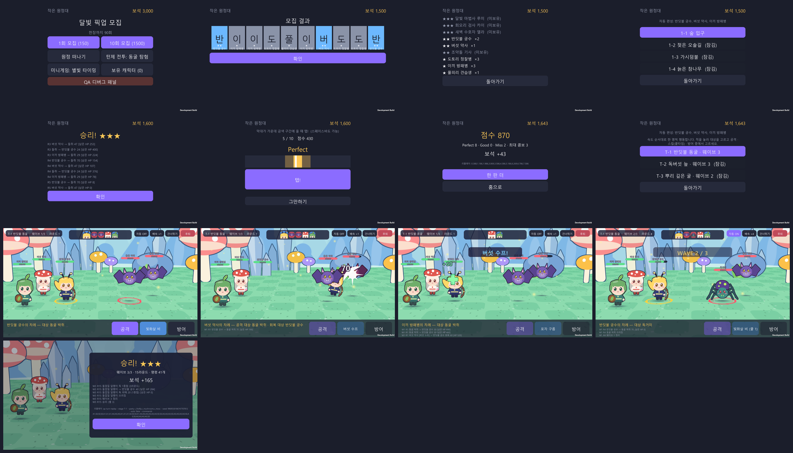

# QA 도구

[← README](../README.md)

게임 코드(Core)를 그대로 불러 쓰는 `qa-tool` CLI와 그 주변 도구의 사용법·실제 출력입니다.

저장소 루트에서 실행합니다.

```bash
cd dotnet && dotnet build && cd ..
alias qa="dotnet run --project dotnet/QaTool --no-build --"
```

## 1. 확률 검증기 `qa gacha-verify`

게임의 모집 코드를 배너당 100만 번 돌려 공시한 확률표와 비교합니다.

- 기본 등급 확률: 카이제곱 적합도 검정 (p ≥ 0.001), 등급별 95% 신뢰구간
- 등급 안 캐릭터 분포: 픽업 50% / 나머지 균등이 맞는지
- **천장 포함 실제 3성 확률**: 기본 2.5% + 90회 천장이면 실제로는 약 2.79%. 공시값과 관측값을 비교
- 천장 동작: 3성 사이 간격이 90회를 넘지 않는지, 간격 분포 히스토그램
- 10연 보정: 10만 번의 10연 중 2성 이상이 없는 경우가 0번인지

```
[b_lumi] 달빛 픽업 모집
  PASS  기본 등급 확률 — χ²=5.71 (자유도 2), p=0.0575
  PASS  ★★★ 캐릭터 분포 — χ²=0.23, p=0.8912
  PASS  공시한 실제 3성 획득률 — 관측 2.787% vs 공시 2.79% (허용 ±0.071%)
  PASS  천장 동작 — 가장 긴 간격 90회 / 천장 90회
  PASS  10연 2성 이상 보정 — 10연 100,000번 중 위반 0번
```

## 2. 기획 데이터 검사기 `qa validate-data`

확률 합계 100%, 없는 캐릭터 참조, 풀 등급 불일치, 픽업 누락, 스탯 범위, 스테이지 선행 관계 순환,
턴제 스킬(없는 스킬 참조, 쿨타임·위력·상태이상 범위, 회복 스킬에 상태이상), 턴제 웨이브 수·적 수,
**공시한 천장 포함 확률이 계산값과 맞는지**까지 검사합니다. 같은 검사가 Unity 빌드 직전 훅(`IPreprocessBuildWithReport`)에도 걸려 있어, 데이터가 틀리면 빌드가 실패합니다.

```
$ qa validate-data --data samples/broken-data
[Error] banners/b_standard: 등급 확률 합계가 100%가 아닙니다: 99.5%
[Error] banners/b_standard: 공시한 천장 포함 3성 확률 2.5%가 계산값 2.79%와 다릅니다.
[Error] banners/b_lumi: 없는 캐릭터를 참조합니다: c_lumii
[Error] stages/1-1: 선행 스테이지가 순환합니다.
...
[Error] skills/s_cd_typo: cooldown 값 30이(가) 허용 범위 0~9를 벗어났습니다.
[Error] skills/s_heal_stun: 자기편 대상(회복) 스킬에는 상태이상을 붙일 수 없습니다.
[Error] turn-stages/T-1: w1.박쥐이(가) 없는 스킬을 참조합니다: s_bite
[Error] turn-stages/T-1: 웨이브 2의 적은 최대 3마리입니다.
...
캐릭터 10 · 배너 2 · 스테이지 4 · 스킬 4 · 턴제 스테이지 2 — 오류 17, 경고 0
```

## 3. 버그 재현 도구 `qa battle-replay` / `qa minigame-replay`

전투와 미니게임은 시드·입력 기록만 있으면 언제든 같은 결과가 나오도록 만들었습니다.
버그 리포트에 시드(또는 미니게임 결과 화면의 리플레이 문자열)만 적으면 개발자가 그대로 재현할 수 있습니다.

```
$ qa battle-replay --stage 1-3 --party c_lumi,c_firefly,c_moss --seed 5
$ qa minigame-replay --taps 0.41,1.93,2.77,3.6,4.42,5.55,6.01,7.2,8.39,9.0
```

턴제 전투는 사람이 명령을 고르므로 **시드 + 아군 명령 목록**이 리플레이 단위입니다(`A1` = 1번 적 공격, `S0` = 스킬(대상 0번), `G` = 방어).
전투 결과 화면에 이 명령줄이 그대로 찍혀, 복사해 붙이면 같은 전투가 다시 나옵니다. 명령이 모자라면 `--auto false`로 그 자리에서 멈춰 "이 차례에서 무엇이 보였는지"를 확인할 수 있습니다.

```
$ qa turn-replay --stage T-1 --party c_kai,c_firefly,c_acorn --seed 3 --commands A1,S0,G
  W1 R1 회오리 검사 카이 → 동굴 박쥐 100 [남은 HP 160]
  W1 R1 반딧불 궁수 [빛화살 비] → 동굴 박쥐 52 [남은 HP 208]
  W1 R1 반딧불 궁수 [빛화살 비] → 동굴 박쥐 52 [남은 HP 108]
  W1 R1 도토리 정찰병 방어
  W1 R1 동굴 박쥐 → 도토리 정찰병 15(방어) [남은 HP 405]
  ...
  W2 R4 독거미 [독니] → 도토리 정찰병 30 [남은 HP 298]
  W2 R4 도토리 정찰병 독 1중첩 (3라운드)
  W2 R4 도토리 정찰병 독 피해 18 (1중첩) [남은 HP 280]
  ...
결과: Victory · 웨이브 3/3 · 11라운드 · 별 3
명령: A1,S0,G,S1,A0,S0,A0,A1,A1,A1,S1,A0,...   ← 앞 3개는 준 명령, 나머지는 자동
```

턴제 규칙(행동 순서 동점 처리, 쿨타임이 줄어드는 시점, 기절·독 중첩, 웨이브 전환, 동시 전멸 = 패배)은
[`TurnBattle.cs`](../UnityProject/Assets/TinyExpedition/Core/Battle/TurnBattle.cs) 맨 위 주석에 기획서처럼 적어 두고, 경계마다 TC(TURN-001~024)를 붙였습니다.

## 3-1. 2.5D 전투 화면과 "화면 = 실제 상태" 검사

턴제 전투는 3D 공간(원근 카메라, 바닥, 깊이가 다른 배경)에 2D 캐릭터 그림을 세운 2.5D 화면입니다. 캐릭터가 달려가 때리고 돌아오고, 맞으면 흔들리며 숫자가 뜨고, 기절은 머리 위 별·독은 보라 방울·방어는 방패로 보입니다.



연출이 붙으면 QA가 걱정할 것이 늘어납니다 — **화면에 보이는 HP가 진짜 HP인가, 배속을 올리면 결과가 달라지지 않는가.** 그래서 이렇게 만들었습니다.

- **연출은 계산하지 않습니다.** Core가 명령 하나로 다음 아군 차례까지 계산해 로그를 남기면, 화면은 그 로그를 한 줄씩 재생만 합니다. 배속·건너뛰기는 재생 속도만 바꾸므로 리플레이(시드 + 명령 목록)는 그대로입니다 (TURN-029).
- **화면 상태를 엔진 밖에 뒀습니다.** "로그를 여기까지 재생했을 때 화면에 보여야 하는 HP·상태"를 [`TurnBattleDisplay`](../UnityProject/Assets/TinyExpedition/Core/Battle/TurnBattleDisplay.cs)(Core, 엔진 참조 없음)가 들고 있고, Unity 쪽은 그 값을 그리기만 합니다. 덕분에 dotnet 테스트가 스테이지 3개 × 파티 4종 × 시드 25개 = 300판을 명령마다 대조합니다 (TURN-025).
- **게임이 스스로 대조합니다.** 재생이 끝날 때마다 화면 상태와 Core 상태를 비교해 다르면 `[TurnView]` 오류 로그(시드·명령 수 포함)를 남깁니다. PlayMode 테스트는 오류 로그가 있으면 실패하고, 자동 플레이는 불일치 수가 0인지 확인합니다.
- **연출 중에는 명령을 받지 않습니다.** 연타로 다음 차례 명령이 잘못 들어가는 것을 막습니다 (TURN-030).

그림은 전부 코드로 그렸습니다(외부 에셋 없음) — [`ART.md`](ART.md).

## 4. TC 추적 리포트 `qa report`

dotnet과 Unity가 내는 NUnit XML을 TC 문서와 이어 HTML 리포트를 만듭니다.
TC별 상태(통과·실패·자동화 누락·미실행·수동), 영역별 통과율, 실패 메시지를 한 페이지로 봅니다.

```
$ qa report --results dotnet=artifacts/dotnet-results.xml,qa-tool=artifacts/qatool-results.xml,unity-playmode=artifacts/unity-playmode.xml \
            --cases docs/test-cases.csv --out artifacts/test-report.html
```

실제 결과: [HTML](reports/test-report.html)



## 5. 뮤테이션 스모크 `scripts/mutation_smoke.py`

"테스트가 다 통과한다"는 것만으로는 테스트가 버그를 잡는지 알 수 없어서,
실제로 생길 법한 버그 38개(천장 off-by-one, 10연 안에서 천장 카운트 초기화 누락, `<`/`<=` 경계 혼동, 보상 중복 지급, 실패한 모집의 재화 차감, 콤보 초기화 누락, 턴제 쿨타임 off-by-one·동시 전멸 오판·기절 합산, qa-tool이 시드를 long으로 읽음 등)를 코드에 하나씩 넣고 테스트가 실패하는지 확인합니다.

```
[검출] 천장 off-by-one (90번째가 아니라 91번째에 확정)  ← GACHA-004, GACHA-005, GACHA-011, GACHA-016, GACHA-017, GACHA-018
[검출] 10연 안에서는 3성이 나와도 천장 카운트가 초기화되지 않음 (1회 모집만 초기화)  ← GACHA-017, GACHA-018
[검출] 10연 보정 대상 장에서는 천장 판정을 건너뜀 (보정이 천장보다 먼저)  ← GACHA-018
[검출] 모집 실패해도 보석이 먼저 빠짐 (차감 순서 오류)  ← GACHA-015
[검출] 미니게임 보상 중복 수령  ← MINI-010
[검출] Perfect 판정 경계 미포함 (< 와 <= 혼동)  ← MINI-002
[검출] 10연 보정 대상(2성) 후보 검사 누락  ← DATA-010
...
[검출] [턴제] 쿨타임 경계 off-by-one (마지막 1턴 일찍 사용 가능)  ← TURN-003, TURN-004
[검출] [턴제] 동시 전멸을 승리로 판정  ← TURN-010
...
[검출] [qa-tool] 시드를 long으로 읽음 (long 최대값보다 큰 시드 거부, 음수는 큰 시드로 바뀜)  ← TOOL-001, TOOL-002, TOOL-003, TOOL-004
[검출] [qa-tool] battle-replay만 시드를 long으로 읽음 (호출부 되돌림)  ← TOOL-004

검출 38/38
```

## 6. 게임 안 QA 디버그 패널

시드 고정, 보석 지급, 천장 직전(89회)으로 이동, 모든 스테이지 열기, 세이브 초기화.
`UNITY_EDITOR || DEVELOPMENT_BUILD`에서만 컴파일되어 출시 빌드에는 들어가지 않습니다.

## 7. 빌드 자동 플레이 `-qaAutoplay`

개발 빌드를 `TinyExpedition.exe -qaAutoplay <폴더>`로 실행하면 홈 → 10연 모집 → 보유 캐릭터 → 원정 1-1 → 미니게임 한 판 → 2.5D 턴제 T-1(대상 골라 직접 공격 → 스킬 → 4배속 자동으로 끝까지)을 스스로 진행하며 각 화면을 확인(화면 이름·버튼 활성, 연출 중 버튼 잠김, 화면 HP = 실제 HP, 화면·전투 상태 불일치 0)하고 스크린샷을 남긴 뒤 종료합니다. 전투 화면의 프레임 시간(평균·95%·최대)도 로그에 남깁니다. 하나라도 어긋나면 종료 코드 1. 미니게임은 실제 시간으로 막대를 보고 누르며, 일부러 4번째마다 빗나가게 해 Miss·콤보 초기화까지 지나갑니다.


